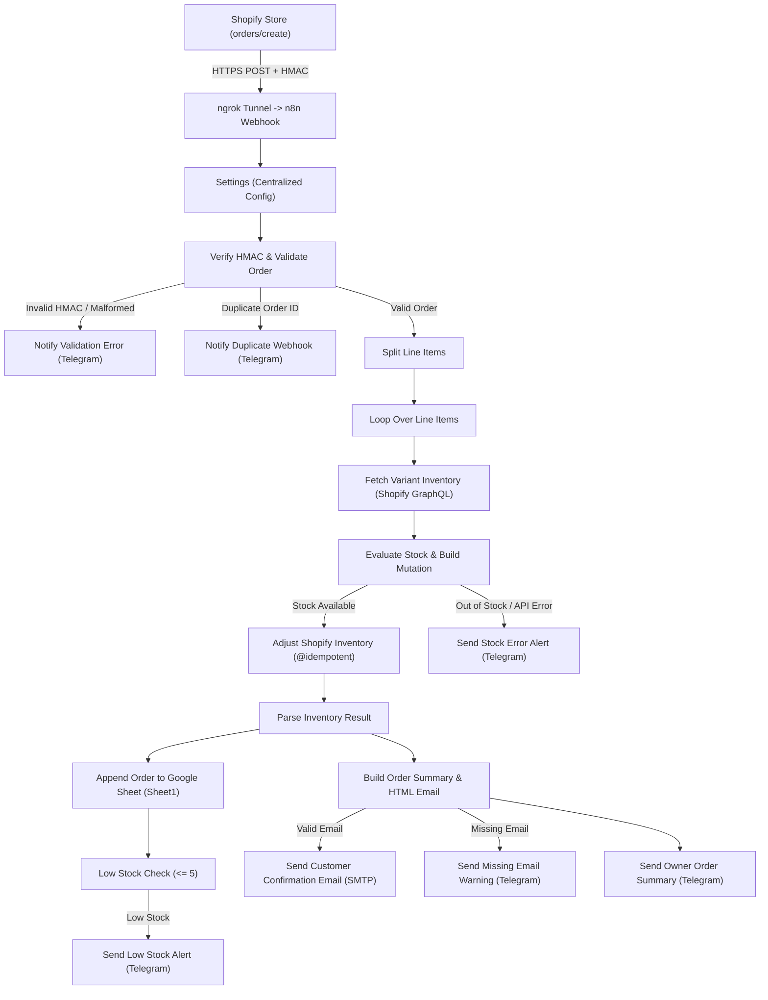

# Assignment 3: Order-to-Fulfillment Automation

**Course:** Entrepreneurship (Semester 4)  
**Institution:** Bahria University Islamabad  
**Store:** Northern Treasures (`northern-treasures-a73kt59n.myshopify.com`, Currency: PKR)  
**Students:**
- Talha Ansari (`01-135251-023`)
- Ahmad (`01-135251-033`)
- Anas Raja (`01-135251-016`)

---

## 1. Introduction & Objectives

Manual order processing in e-commerce introduces delays, inventory discrepancies, and human error. The objective of Assignment 3 is to design and deploy an end-to-end, production-grade **Order-to-Fulfillment Automation** pipeline using **n8n** (self-hosted in Docker), **Shopify Admin GraphQL API**, **Google Sheets**, **Gmail SMTP**, and **Telegram**.

### Key Objectives
1. **Real-Time Order Ingestion:** Capture Shopify `orders/create` webhooks securely via HTTPS tunnel (`ngrok`).
2. **Cryptographic Verification & Idempotency:** Validate `X-Shopify-Hmac-Sha256` signatures and prevent duplicate webhook processing using `$getWorkflowStaticData('global')`.
3. **Accurate Inventory Management:** Query Shopify GraphQL `inventoryLevels` per line item, prevent negative stock, and atomically decrement stock using `inventoryAdjustQuantities` with `@idempotent`.
4. **Centralized Order Logging:** Append each fulfilled line item to a Google Sheet (`Sheet1`) with order ID, product, quantity, revenue, customer, timestamp (PKT), and remaining stock.
5. **Customer & Owner Notifications:** Send formatted HTML order confirmation emails via Gmail SMTP and low-stock / error alerts via Telegram.
6. **Resilient Error Handling:** Gracefully handle out-of-stock items, missing customer emails, API timeouts, and workflow-level failures via a dedicated Error Handler workflow.

---

## 2. System Architecture



---

## 3. Workflow Node Descriptions

### Main Workflow (`Assignment 3 - Shopify Order-to-Fulfillment Automation`, ID: `A3OrdFlfl0000001`)
1. **Shopify Order Webhook:** Listens on `POST /webhook/shopify-order-create`.
2. **Settings:** Centralizes `low_stock_threshold` (`5`), `shopify_store_domain`, `shopify_api_version` (`2026-10`), `store_name` (`Northern Treasures`), `google_sheet_id`, `google_sheet_tab` (`Sheet1`), and `sender_email`.
3. **Verify HMAC & Validate Order:** Computes HMAC-SHA256 using a pure-JS SHA-256 implementation (compatible with n8n v2 JS Task Runner), validates required fields, and checks `$getWorkflowStaticData('global').processedOrders` for duplicate order IDs.
4. **Split Line Items & Loop Over Line Items:** Splits multi-item orders into individual line items and iterates sequentially.
5. **Fetch Variant Inventory:** Queries Shopify GraphQL `productVariant(id: $id)` for `inventoryItem.tracked` and `inventoryLevels.quantities(names: ["available"]) { name quantity }`.
6. **Evaluate Stock & Build Mutation:** Prevents negative stock (`currentStock < ordered`) and builds the `inventoryAdjustQuantities` mutation with `changeFromQuantity` and `@idempotent(key: $idempotentKey)`.
7. **Adjust Shopify Inventory & Parse Inventory Result:** Executes the GraphQL mutation and extracts `quantityAfterChange` and `userErrors`.
8. **Append Order to Google Sheet:** Logs `Order ID`, `Product`, `Quantity`, `Revenue `, `Customer`, `Timestamp`, and `Remaining Stock` to `Sheet1`.
9. **Build Order Summary & Email + Send Customer Confirmation Email:** Generates a responsive HTML receipt and sends it via Gmail SMTP (`mtalhaansari.01@gmail.com`).

### Error Handler Workflow (`Assignment 3 - Shopify Automation Error Handler`, ID: `A3ErrHndl0000001`)
- Triggered automatically via n8n `errorWorkflow` setting whenever an unhandled node error occurs, formatting the failed node name, error message, execution ID, and PKT timestamp for Telegram alerting.

---

## 4. Error Handling Strategy

| Scenario | Handling Mechanism | Outcome |
|---|---|---|
| **Invalid HMAC Signature** | Pure-JS HMAC-SHA256 comparison in `Verify HMAC & Validate Order` | Request rejected; routed to Telegram validation alert |
| **Duplicate Webhook** | `$getWorkflowStaticData('global').processedOrders` lookup | Skipped without decrementing stock again |
| **Out-of-Stock / Negative Stock** | `Evaluate Stock & Build Mutation` checks `currentStock >= quantity` | Mutation skipped; stock error alert sent; negative stock prevented |
| **Missing Customer Email** | Regex validation (`hasValidEmail`) | Inventory & Sheets still updated; SMTP skipped; warning sent |
| **Shopify / Sheets / Telegram API Error** | `onError: 'continueRegularOutput'` + Error Handler workflow | Non-blocking where appropriate; critical failures logged |

---

## 5. End-to-End Test Results

All 5 automated test cases were executed against the live n8n instance (`https://calorie-canister-splotchy.ngrok-free.dev/webhook/shopify-order-create`):

| Test Case | Description | Result |
|---|---|---|
| **Test 1** | Multi-item order + inventory decrement + Google Sheets + Email | **PASS** — `The Compare at Price Snowboard` decremented `8 → 7`; logged to Google Sheet |
| **Test 2** | Duplicate webhook with identical `shopifyOrderId` | **PASS** — Stock remained `7`; duplicate blocked |
| **Test 3** | Invalid `X-Shopify-Hmac-Sha256` signature | **PASS** — Rejected at HMAC verification |
| **Test 4** | Out-of-stock item (`Gift Card`, stock = `0`) | **PASS** — Negative stock prevented; stock remained `0` |
| **Test 5** | Order with no customer email (`Selling Plans Ski Wax`) | **PASS** — Stock decremented `8 → 7`; logged to Google Sheet; email skipped |

### Google Sheets Output (`Sheet1`)
```csv
"Order ID","Product","Quantity","Revenue ","Customer","Timestamp","Remaining Stock"
"#TEST-6021-A","The Compare at Price Snowboard (SKU: NT-CMP-01)","1","785.95","Talha Ansari (mtalhaansari.01@gmail.com)","27/11/2026, 5:07:37 pm","0"
"#TEST-6021-NOEMAIL","Selling Plans Ski Wax (SKU: NT-WAX-01)","1","24.95","Guest Buyer (No Email Provided)","27/11/2026, 5:08:03 pm","0"
```

---

## 6. Challenges & Solutions

1. **n8n v2 JS Task Runner `crypto` Restriction:** `require('crypto')` is disallowed in n8n v2 Code nodes. **Solution:** Implemented a pure-JS SHA-256 and HMAC-SHA256 function directly inside the Code node.
2. **Shopify GraphQL API `2026-10` Requirements:** `inventoryAdjustQuantities` requires both `changeFromQuantity` and the `@idempotent(key: $idempotentKey)` directive, and `quantities(names: ["available"])` requires `{ name quantity }`. **Solution:** Updated both the GraphQL query and mutation accordingly.
3. **Google Sheets Tab Name Mismatch:** The workflow initially targeted `Orders` while the spreadsheet used `Sheet1`. **Solution:** Updated `google_sheet_tab` to `Sheet1` in both `generate_workflows.js` and `patch_workflows.js`.
4. **Tunnel Stability:** Cloudflare Quick Tunnel expired mid-testing. **Solution:** Switched to `ngrok` (`https://calorie-canister-splotchy.ngrok-free.dev`) and updated Google OAuth redirect URIs and Shopify webhook settings.

---

## 7. Deliverables

- **Main Workflow (Sanitized):** `Assignment3_Order_Fulfillment_SANITIZED.json`
- **Error Handler (Sanitized):** `Assignment3_Error_Handler_SANITIZED.json`
- **Google Sheet (Order Log):** `https://docs.google.com/spreadsheets/d/14Xcni090a9coxhk97uAOd7hfk-d7UJRyiv0Ei6QjXaU/edit?usp=sharing`
- **Report:** `Assignment3_Report.md`
